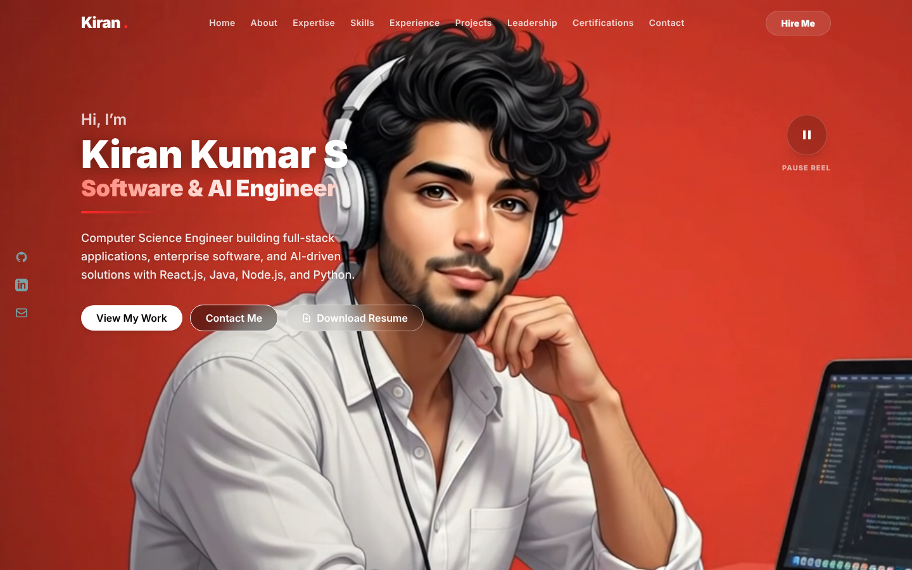
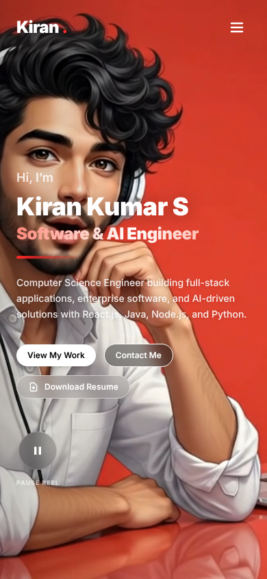
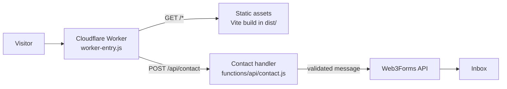

<div align="center">

# Kiran Kumar S · Portfolio

**Personal portfolio for a Software & AI Engineer, live at [me.nmstudios.ai](https://me.nmstudios.ai).**

[](https://github.com/kiran-kumars953/personal-portfolio-showcase/actions/workflows/ci.yml)
[](https://me.nmstudios.ai)
[](LICENSE)


</div>

<p align="center">
  
  &nbsp;
  
</p>

## What it is

A fast, responsive single-page site that tells a recruiter who I am in ten seconds and lets them reach me in one click: a looping hero reel, experience, projects, leadership, certifications, a downloadable resume and a working contact form.

## Features

- **Responsive layout** from 360 px phones to wide desktops, built with Tailwind CSS 4.
- **Motion** with Framer Motion and AOS, plus a pausable hero video.
- **Working contact form**: a Cloudflare Worker validates the message and relays it through Web3Forms. The access key lives in a Cloudflare secret, never in the code.
- **SEO and social cards**: Open Graph and Twitter meta tags with a 1200×627 preview image.
- **Lean assets**: WebP imagery and a single static bundle served from Cloudflare's edge.

## Architecture



## Tech stack

| Area | Tech |
|---|---|
| UI | React 19, Vite, Tailwind CSS 4, Framer Motion, AOS |
| Edge | Cloudflare Workers (static assets + contact API) |
| Email | Web3Forms |
| Quality | ESLint, Vitest, GitHub Actions |

## Project structure

```
src/
  components/      One component per section (Hero, About, Projects, Contact, ...)
  assets/          Hero video and images
functions/api/     Contact form handler (also used by Cloudflare Pages)
worker-entry.js    Worker: routes /api/contact, serves everything else from dist/
tests/             Vitest tests for the contact API and Worker routing
public/            Resume PDF, favicon, social preview image
```

## Run locally

Requires Node.js 20.19 or newer.

```bash
git clone https://github.com/kiran-kumars953/personal-portfolio-showcase.git
cd personal-portfolio-showcase
npm ci
npm run dev            # http://localhost:5173
```

To test the contact form locally, put your own key in `.dev.vars` (git-ignored) and run the Worker:

```bash
echo "WEB3FORMS_ACCESS_KEY=<your-key>" > .dev.vars
npm run dev:worker
```

## Tests and checks

```bash
npm run lint
npm test         # Vitest: validation, missing key, success, upstream failure, bad JSON, routing
npm run build
```

CI runs all three on every push and pull request.

## Deploy

```bash
npx wrangler secret put WEB3FORMS_ACCESS_KEY   # once
npm run deploy:worker                          # build + wrangler deploy
```

## Roadmap

- [ ] Lighthouse CI budget in the pipeline
- [ ] Spam protection (Cloudflare Turnstile) on the contact form
- [ ] Project case-study pages

## License

Code is [MIT](LICENSE). Personal content (photos, video, resume) © Kiran Kumar S, not licensed for reuse.
